# zn Architecture

zn-gate is a **lightweight checkpoint on your machine**, placed between your AI coding agent and everything it does not control: your prompts, the files it reads, web pages, and the tools and MCP servers it calls. It runs locally, needs no account, and sends nothing off the machine by default.

<picture><source media="(prefers-color-scheme: dark)" srcset="diagrams/architecture-animated-dark.svg"></picture>

## Three checks, one local engine

zn-gate checks each step of a tool call. The same local pieces serve all three checks:

| Check | When it runs | What it looks for |
|---|---|---|
| `analyze_prompt` | Before the agent acts on a prompt | Prompt injection, jailbreaks and role-play tricks, file-read and exfiltration requests |
| `check_tool_call` | Before a tool runs | Prompt-injection wording, requests for secrets and secret-file names in the arguments, and secrets in arguments (masked). It is a text check: it does not judge whether a shell command or a query is destructive |
| `check_tool_result` | After a tool runs, before the model sees the output | Indirect injection hidden in the output, secrets and personal data (redacted) |

The local pieces:

- **Rules engine.** Signatures plus normalization against homoglyphs, zero-width characters, BiDi overrides and comment splicing; shell commands that decode Base64 text and run it are recognised, but a Base64 string on its own is not decoded. It checks prompts, tool arguments, tool output and MCP tool descriptions.
- **PII and secret scrubber.** Replaces the secrets it recognises (provider keys, tokens, JWTs, private keys, database URL passwords) and detects personal data (cards, IBAN, national IDs, e-mail, phone). The model sees a marker or `[REDACTED_...]` text instead of the value.
- **Encrypted vault.** Keeps the real values of your secrets on your machine. The agent works with stable markers such as `__ZN_AWS_KEY_1__`, and `zn run` puts a value in the environment of a command only when you approved it.
- **Hash-chained audit log.** Records each assessment in `~/.zn/evidence.jsonl`.

## How it attaches to your agent

- **Local hooks.** For Claude Code, Codex CLI, Cursor, OpenCode, Antigravity and ZCode desktop app (and, as experimental adapters, Gemini CLI and Copilot CLI), `zn hooks install <agent>` registers zn-gate's hooks, so it also sees the agent's built-in tools: it blocks reads of secret files and pasted secrets, and scrubs shell output and file contents. (In Cursor, only MCP tool output is scrubbed; in Antigravity and ZCode desktop app, no tool output is rewritten.) What each agent allows is in [Agent compatibility](compat.md).
- **MCP server and `shield`.** In editors that only support MCP servers, zn-gate offers its checks as MCP tools (`analyze_prompt`, `check_tool_call`, `check_tool_result`) and can wrap your other MCP servers with `zn-gate shield`. See [Editors and coding agents](editors/README.md).
- **Library.** Node.js and Python functions, and framework integrations, run the same checks inside your own code ([API reference](api-reference.md)).

## Key Architectural Principles

1. **Minimal Dependencies:**
   `zn-gate-py` (PyPI) uses the Python standard library only. `zn-gate` (npm) has no runtime dependencies except `age-encryption` (and its `@noble`/`@scure` dependencies) for the secret vault, bundled in the npm package at the versions pinned in `package-lock.json`. No native compilation.

2. **Deterministic Local Fast Path:**
   Local evaluation uses compiled regular expressions, homoglyph normalization, and a 2048-entry LRU cache. Measured latencies by input size, with hardware and the script to reproduce them, are in the [npm package README](../packages/zn-gate/README.md#performance-local-rules-engine-no-network).

3. **Optional Cloud Second Opinion (opt-in):**
   Only prompt analysis (`analyze()`) can query the cloud classifier, and only when both `ZN_API_KEY` and `ZN_CLOUD=1` are set, or the user ran `zn-gate connect` (`ZN_LOCAL_ONLY=true` overrides it). Attacks caught by the local rules are blocked in-process first, and the text is secret-redacted locally before it is sent (personal data, and a secret zn-gate does not recognize, is not removed). If the cloud call fails, the local result stands (`fallback: true`) and nothing is blocked because of it. Tool arguments, tool output and tool descriptions never leave the machine.

4. **Hash-Chained Local Audit Log:**
   Each recorded assessment is hashed with SHA-256 and chained into `~/.zn/evidence.jsonl`, with canonical JSON in both the Node and Python implementations. The chain detects accidental or partial edits; it is not tamper-proof against someone with write access to the file, who can recompute it.

See also: [What leaves your machine](../README.md#what-leaves-your-machine), the [threat model](threat-model.md) and the [glossary](glossary.md).

## Read next

- [Check that it works](check.md): run `zn-gate check` to confirm zn-gate is protecting your agent.
- [zn-gate reach](reach.md): see on one screen what your coding agents can reach.
- [See what zn-gate did this week](report.md): read the weekly `zn-gate report`.
- [Remove zn-gate](uninstall.md): uninstall in one step or piece by piece.
