# zn Architecture

zn-gate is a **lightweight checkpoint on your machine**, placed between your AI coding agent and everything it does not control: your prompts, the files it reads, web pages, and the tools and MCP servers it calls. It runs locally, needs no account, and sends nothing off the machine by default.

<picture><source media="(prefers-color-scheme: dark)" srcset="diagrams/architecture-animated-dark.svg"></picture>

**How to read this diagram**

- The boxes: untrusted input (prompts, files, web, MCP) on the left, the agent and its tools on the right, and zn-gate between them with one box per check (`analyze_prompt`, `check_tool_call`, `check_tool_result`).
- The arrows: input goes through the three checks and reaches the agent as clean input, and output comes back redacted. The bottom row (rules engine, scrubber, encrypted vault, and the hash-chained decision log, the "audit log" box in the diagram) is used by all three checks.
- The cloud path: only with `ZN_CLOUD=1` and `ZN_API_KEY` set, prompts with detected secrets removed go to the Galvanize 3 classifier at `api.usezn.com`.

## Three checks, one local engine

zn-gate checks each step of a tool call. The same local pieces serve all three checks:

| Check | When it runs | What it looks for |
|---|---|---|
| `analyze_prompt` | Before the agent acts on a prompt | Prompt injection, jailbreaks and role-play tricks, file-read and exfiltration requests |
| `check_tool_call` | Before a tool runs | Prompt-injection wording, requests for secrets and secret-file names in the arguments, and secrets in arguments (masked). It is a text check: it does not judge whether a shell command or a query is destructive |
| `check_tool_result` | After a tool runs, before the model sees the output | Indirect injection hidden in the output, secrets and personal data (redacted) |

The local pieces:

- **Rules engine.** Signatures plus normalization against homoglyphs, zero-width characters, BiDi overrides and comment splicing; shell commands that decode Base64 text and run it are recognised, but a Base64 string on its own is not decoded. It checks prompts, tool arguments, tool output and MCP tool descriptions.
- **Scrubber.** Replaces the secrets it recognises (provider keys, tokens, JWTs, private keys, database URL passwords) and detects personal data (cards, IBAN, national IDs, e-mail, phone). The model sees a marker or `[REDACTED_...]` text instead of the value.
- **Encrypted vault.** Keeps the real values of your secrets on your machine. The agent works with stable markers such as `__ZN_AWS_KEY_1__`, and `zn run` puts a value in the environment of a command only when you approved it.
- **Hash-chained decision log.** Records each assessment in `~/.zn/evidence.jsonl`.

## One tool call, step by step

Here is one tool call from the agent to the answer, using only what is described on this page:

1. The agent gets a prompt. `analyze_prompt` checks it first for prompt injection, jailbreaks and requests to read files or exfiltrate data.
2. The agent decides to call a tool, for example one on an MCP server.
3. Before the tool runs, `check_tool_call` reads the arguments as text. It looks for injection wording, requests for secrets, secret-file names and secrets, which it masks.
4. If the arguments pass, the tool runs. If you approved a command, `zn run` fills in the real value of a secret marker such as `__ZN_AWS_KEY_1__` at that point. The agent itself only works with the marker.
5. After the tool runs and before the model sees the output, `check_tool_result` looks for indirect injection hidden in it. Secrets and personal data are redacted.
6. The model sees the cleaned output, with a marker or `[REDACTED_...]` text in place of any removed value, and gives its answer.
7. Each assessment is recorded in the hash-chained decision log at `~/.zn/evidence.jsonl`.

All of these checks use the local engine. Tool arguments never leave the machine, and neither does tool output, except in one opt-in case: if you ran `zn-gate connect` and also set `hooks.cloudCheckToolOutput: true` in your own `~/.zn/config.json` (off by default, also if you already connected), the Claude Code hook sends a capped sample of web, MCP and shell results with secrets and personal data (email addresses, phone numbers, IBANs and card numbers) removed to the cloud classifier. Otherwise nothing from tool output is sent. See [Key Architectural Principles](#key-architectural-principles) for the details.

## How it attaches to your agent

- **Local hooks.** For Claude Code, Codex CLI, Cursor, OpenCode, Antigravity, ZCode desktop app and GitHub Copilot (and, as an experimental adapter, Gemini CLI), `zn hooks install <agent>` registers zn-gate's hooks, so it also sees the agent's built-in tools: it blocks reads of secret files and pasted secrets, and scrubs shell output and file contents. (In Cursor, only MCP tool output is scrubbed; in Antigravity and ZCode desktop app, no tool output is rewritten.) What each agent allows is in [Agent compatibility](compat.md).
- **MCP server and `shield`.** In editors that only support MCP servers, zn-gate offers its checks as MCP tools (`analyze_prompt`, `check_tool_call`, `check_tool_result`) and can wrap your other MCP servers with `zn-gate shield`. See [Editors and coding agents](editors/README.md).
- **Library.** Node.js and Python functions, and framework integrations, run the same checks inside your own code ([API reference](api-reference.md)).

## Two more views of the same flow

Where each check sits in a tool call, as an MCP server or as the `shield` proxy around other servers:

<picture><source media="(prefers-color-scheme: dark)" srcset="diagrams/tool-call-sequence-animated-dark.svg"></picture>

**How to read this diagram**

- The boxes: the agent, zn-gate (on your machine) and the tool or MCP server. Time runs from top to bottom.
- The arrows going to zn-gate: `analyze_prompt` is answered with allow, or block with the rule that fired; `check_tool_call` (name, arguments) is answered with allow with secrets masked, or block.
- The arrows after the tool runs: the output comes back through `check_tool_result` (or through `shield`) and reaches the agent with secrets redacted, or neutralized if it carries an injection.

What goes where on your machine, and what can leave it:

<picture><source media="(prefers-color-scheme: dark)" srcset="diagrams/data-flow-animated-dark.svg"></picture>

**How to read this diagram**

- The boxes: the agent, zn-gate (rules engine and secret redaction) and the tools and MCP servers (files, shell, web, databases), all inside "Your machine".
- The arrows: tool calls and prompts go to zn-gate, allowed calls reach the tools with secrets masked, and tool output comes back through zn-gate as redacted output and verdicts.
- The cloud arrow: nothing leaves the machine by default. Only with `ZN_CLOUD=1` and `ZN_API_KEY` set, prompts with detected secrets removed go to the Galvanize 3 classifier at `api.usezn.com`.

## Key Architectural Principles

1. **Minimal Dependencies:**
   `zn-gate-py` (PyPI) uses the Python standard library only. `zn-gate` (npm) has no runtime dependencies except `age-encryption` (and its `@noble`/`@scure` dependencies) for the secret vault, bundled in the npm package at the versions pinned in `package-lock.json`. No native compilation.

2. **Deterministic Local Fast Path:**
   Local evaluation uses compiled regular expressions, homoglyph normalization, and a 2048-entry LRU cache. Measured latencies by input size, with hardware and the script to reproduce them, are in the [npm package README](../packages/zn-gate/README.md#performance-local-rules-engine-no-network).

3. **Optional Cloud Second Opinion (opt-in):**
   Two things can query the cloud classifier: prompt analysis (`analyze()`), and, only with the separate tool-output opt-in described below, the Claude Code hook for tool output. Prompt analysis runs when `ZN_API_KEY` and `ZN_CLOUD=1` are set, or the user ran `zn-gate connect`; the tool-output hook is off by default and runs only after `zn-gate connect` and with `hooks.cloudCheckToolOutput: true` in the user's own `~/.zn/config.json`. That setting and the connect record are read from the `.zn` folder in the home folder of the operating-system account (`os.userInfo()`), not from `HOME`, `USERPROFILE` or `ZN_HOME`, and the path stays off when those point zn-gate elsewhere or the system reports no home folder, because a project can set environment variables for the agent (`ZN_LOCAL_ONLY=true` overrides both). Attacks caught by the local rules are blocked in-process first, and the text is secret-redacted locally before it is sent (personal data, and a secret zn-gate does not recognize, is not removed). If the cloud call fails, the local result stands (`fallback: true`) and nothing is blocked because of it. Tool arguments and tool descriptions never leave the machine. Tool output stays local too, except that the Claude Code hook, when the user ran `zn-gate connect` and turned that path on, also sends a sample of at most 16 KiB, counted in bytes of UTF-8 text (the first 12 KiB and the last 4 KiB), of each web, MCP or shell result after the same secret redaction and with email addresses, phone numbers, IBANs and card numbers replaced, and a failed call changes nothing (an answer with a verdict that is neither allow nor block adds the same note; removing the setting or setting it to false turns that off).

4. **Hash-Chained Local Decision Log:**
   Each recorded assessment is hashed with SHA-256 and chained into `~/.zn/evidence.jsonl`, with canonical JSON in both the Node and Python implementations. The chain detects accidental or partial edits; it is not tamper-proof against someone with write access to the file, who can recompute it.

See also: [What leaves your machine](../README.md#what-leaves-your-machine), the [threat model](threat-model.md) and the [glossary](glossary.md).

## Reading the decision log by hand

The decision log (`~/.zn/evidence.jsonl`) is a plain text file with one JSON record on each line. `zn-gate evidence` shows it for you ([worked example](examples/evidence-example.md), [options](cli.md#evidence)), but you can also open the file in any editor. This is not the vault audit log (`audit.jsonl`), which records only when the vault gave out a secret.

Each record has these fields:

| Field | What it holds |
|---|---|
| `id` | A unique name for the record. |
| `timestamp` | When zn-gate decided, in UTC. |
| `agent_environment` | The agent that asked, or `unknown`. |
| `phase` | What was checked, for example `tool-call`. |
| `tool_name` | The tool the agent tried to use, or `unknown`. |
| `payload_sha256` | The SHA-256 fingerprint of the text that was checked. The text itself is not stored. |
| `payload_preview` | The first 120 characters of that text, with secrets replaced first. |
| `verdict` | `allow`, `block` or `shadow` (recorded only, nothing stopped). |
| `rule` | The rule that decided, or `null`. |
| `reason` | A short explanation, or `null`. |
| `confidence` | A number from 0 to 1. |
| `latency_us` | How long the check took, in microseconds. |
| `engine` | What made the decision. `oss-deterministic` is the local rules engine. |
| `prev_hash` | The `record_hash` of the record before this one. |
| `record_hash` | The fingerprint of this record. |

Here are two records from a test log, with the lines wrapped so they fit. In the file, each record is one line. The values are only examples.

```json
{"id":"ev_mw6upplz_4d112c50","timestamp":"2026-11-07T20:23:49.991Z",
 "agent_environment":"claude-code","phase":"tool-call","tool_name":"Read",
 "payload_sha256":"87a00fed4b691b341e0e6e77d04ce66891a8e4a3372156a14e02b949f97eb1be",
 "payload_preview":"{\"file_path\":\".env\"}","verdict":"block",
 "rule":"hook-pre_tool-policy","reason":"example reason","confidence":1,
 "latency_us":120,"engine":"oss-deterministic",
 "prev_hash":"0000000000000000000000000000000000000000000000000000000000000000",
 "record_hash":"d56a763dc34e0d6c7bf7699afeec078c40010e1630be49b993a5bc1ef40f1428"}
{"id":"ev_mw6uppml_e4be893c","timestamp":"2026-11-07T20:23:50.013Z",
 "agent_environment":"claude-code","phase":"tool-call","tool_name":"Bash",
 "payload_sha256":"4cf29611a66934862f29acfcc817e30b905c1ab73d5e65831413eb6b454d49db",
 "payload_preview":"{\"command\":\"ls\"}","verdict":"allow","rule":null,"reason":null,
 "confidence":1,"latency_us":0,"engine":"oss-deterministic",
 "prev_hash":"d56a763dc34e0d6c7bf7699afeec078c40010e1630be49b993a5bc1ef40f1428",
 "record_hash":"089a19752b035599bacb839ddba6d770b3da2e7cf636c37d0d9b760d4af80458"}
```

How the records link:

- The first record of a log has a `prev_hash` of 64 zeros.
- Every later record carries, as its `prev_hash`, the `record_hash` of the record before it. In the example, the second `prev_hash` is the first `record_hash`.
- A `record_hash` is the SHA-256 of the record's `prev_hash`, a colon, and the rest of the record (every field except `record_hash`) written as JSON.
- If someone edits a record, its `record_hash` no longer matches. If someone removes or reorders records, a `prev_hash` no longer points at the record before it.

To check the whole chain, run `zn-gate evidence --verify`. It ends with exit code `0` when every record matches and `1` when one does not, and a damaged log is explained in [Troubleshooting](troubleshooting.md#10-the-evidence-log--is-damaged). As said above, this finds accidental or partial edits and does not stop someone who can write to the file and recalculates every hash.

## Read next

- [Check that it works](check.md): run `zn-gate check` to confirm zn-gate is protecting your agent.
- [zn-gate reach](reach.md): see on one screen what your coding agents can reach.
- [See what zn-gate did this week](report.md): read the weekly `zn-gate report`.
- [Remove zn-gate](uninstall.md): uninstall in one step or piece by piece.
